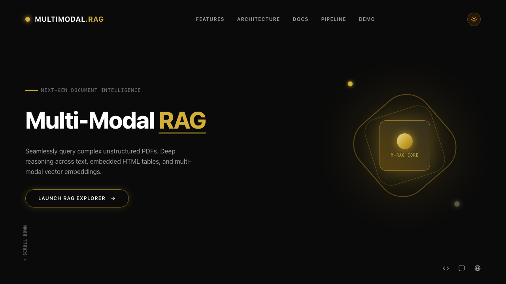
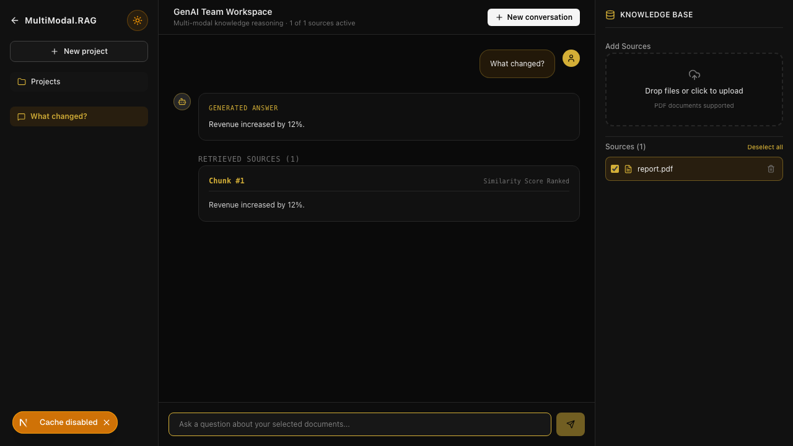

# MultiModal RAG Demo

This walkthrough demonstrates the MVP without requiring knowledge of its internal implementation.

## 1. Open the application

Start both services using the instructions in the root README, then open `http://localhost:3000`.



Select **Launch RAG Explorer** to enter the document workspace.

## 2. Add source documents

1. Select **Drop files or click to upload**.
2. Choose a PDF containing text, tables, or images.
3. Follow the ingestion stepper through parsing, extraction, summarization, and embedding.
4. Confirm the document appears in the Knowledge Base and is selected.

## 3. Ask a grounded question

1. Select the documents that should be searched.
2. Enter a question in the chat field.
3. Watch the answer stream into the active conversation.
4. Review the retrieved source cards beneath the answer.



## 4. Inspect evidence

- Expand an extracted table to inspect its original structure.
- Open an extracted image in the citation lightbox.
- Deselect a source and repeat the question to compare retrieval scope.

## 5. Verify persistence

Refresh the page and confirm that conversations, messages, citations, and the document list are restored from the backend.

## Automated demo coverage

The Playwright workflow reproduces the landing-page and cited-answer path with deterministic mocked API responses:

```bash
cd mmr-frontend
npm run test:e2e
```
